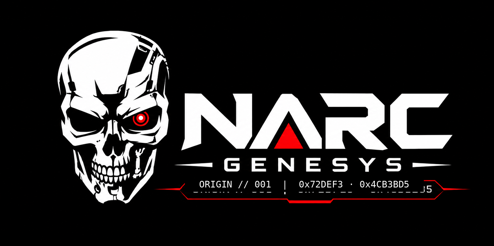

# NARC Genesys

<p align="center"></p>
![Strong 3500 +] ![HomeMade] ![License][]

NARC Genesys 5.0
UCI chess engine by Madushan Dissanayake, Sri Lanka

NARC Genesys is the next major public release of my NARC engine project (the previous release was NARC NEXT
4.1). The purpose of this project is to create a highly optimized and efficient chess engine from scratch, with
some AI help. It was carried out as an individual project, and it helped me get into chess engine development.
During development I gathered a lot of knowledge about engines and gained a good understanding of the factors
that contribute to a chess engine's strength. With AI assistance I was able to test hundreds of ideas very
quickly, within a span of just three months. Every idea was tested with SPRT matches, and most of them had to be
rejected. Many of the early tests were done without a proper understanding of what I was doing, and they wasted
a lot of compute in the early stages of the project. In my tests, the main strength improvements came from
choosing high-quality training data and from optimizing the NNUE architecture.

NARC Genesys is completely rewritten and can be considered a full re-implementation of the original NARC engine.
It went through a process of iterative self-improvement, starting from a hand-crafted evaluation (HCE). The
final NNUE was trained on a mixture of high-quality, filtered training positions: positions from the engine's own
self-play, and positions taken from licensed data sources. To prevent any knowledge distillation from other
authors' engines, the positions were relabelled by my own engines, mostly by NARC Genesys itself during its
development. Obtaining high-quality and diverse data was one of the primary objectives of this project. Human
games from Lichess were also used, but only filtered, high-quality positions went into the final corpus, and
they were relabelled by the best version of the engine at that point.

This is an individual project carried out in a compute-constrained environment, so using compute resources
efficiently was one of the biggest challenges. Development followed an iterative cycle. The first NNUE was
trained on only 1M self-play positions, and it outperformed the HCE version by roughly 100 Elo. The same process
was then repeated with the dataset growing step by step. The label quality of each new corpus also improved,
because each time a newer, stronger version was used to produce self-play data or to relabel the data.

The networks of most other 3500+ engines are trained on billions, or even hundreds of billions, of positions.
NARC Genesys was trained on only about 249M high-quality positions, and yet it competes with those engines:
its estimated strength is about 3600 on the CCRL Blitz scale. The engine has not yet hit a strength wall;
further development is currently limited by access to compute resources and by my own understanding.

Estimated strength: about 3600 CCRL Blitz (gauntlet against nine CCRL-rated engines at 8+0.08, 1,736 games).

## Build

```bash
./build.sh native build/narc-genesys.exe   # targets: native, avx512, bmi2 (PEXT), avx2, sse42, generic, debug
./release.sh                               # every target into release/NARC-Genesys-5.0/, checked and zipped
```

Requires g++ 12 or newer (MSYS2 UCRT64 on Windows). The network `networks/narc-genesys.nnue`
(DRNNUE03, 16 king buckets, trained on 249M positions) is embedded in the executable; `NET=<file>` picks another.


## Versions

| Engine | Rating (CCRL Blitz) | Official CCRL (40/15) rating |
|---|---|---| 
| `NARC Engine` | 2950 (approx)  | Not published for Testing |
| `NARC NEXT 4.1 ` | 3400 (approx) | 3320 (rank #168 )| 
| `NARC Atlas 4.5` | 3500 (approx) | Private | 
| `NARC Genesys 5.0 ` | 3600 (approx)| Pending | 


## Commands

| Command | Purpose |
|---|---|
| `narc-genesys bench [depth]` | fixed-depth search over 12 positions; the node total is the search signature (1,405,722 at depth 12) |
| `narc-genesys perftsuite` | perft on 7 standard positions with known counts (exit code 1 on any mismatch) |
| `narc-genesys perft <depth>` | perft divide from the start position |
| UCI: `d`, `eval`, `perft <depth>`, `bench [depth]` | board and key, evaluation, divide, bench |
